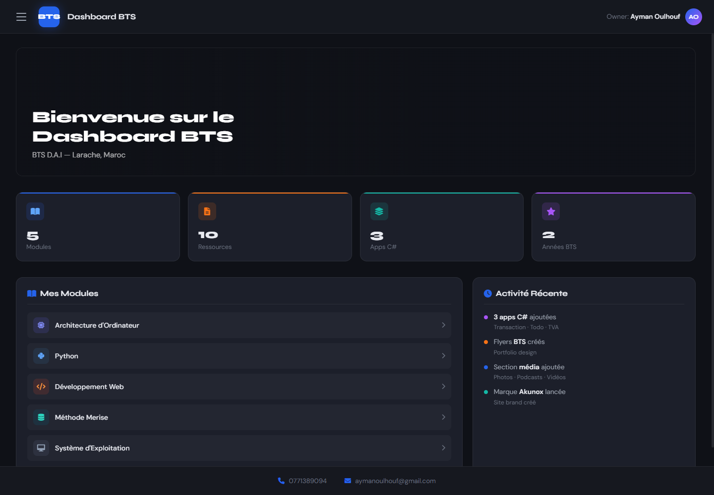
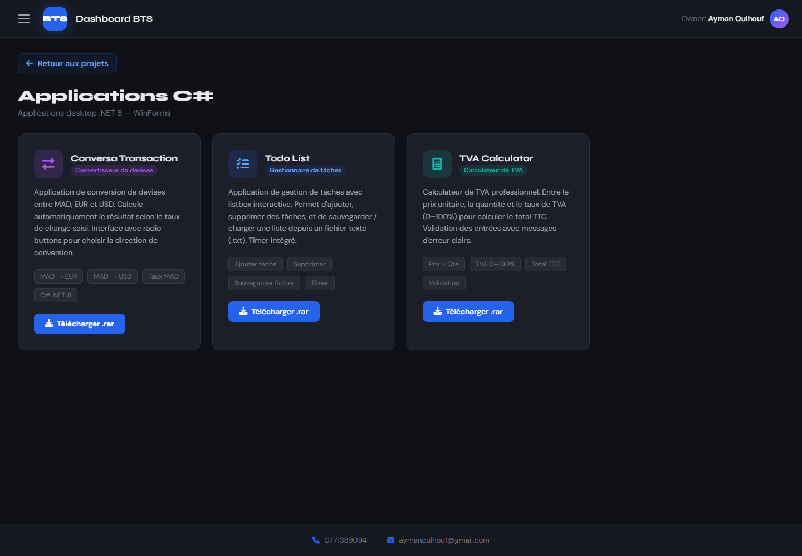

# BTS Larache Dashboard

A single-page learning dashboard built during my **BTS DAI** (*Développement d'Applications Informatiques*) at Larache, Morocco. It brings coursework, C# desktop apps, and design work into one dark, responsive interface.

**[Open the live dashboard →](https://aymanoulhouf.github.io/my-first-project/)**



## What's inside

- **Module hub** — Architecture d'Ordinateur, Python, Développement Web, Méthode MERISE, and Système d'Exploitation, with the related course PDFs.
- **BTS guide** — what the BTS is, the DAI stream, internships and PFE, the Larache campus, and options after graduation.
- **C# applications** — three .NET 8 WinForms projects with screenshots and `.rar` downloads:
  - **Conversa Transaction** — MAD/EUR/USD currency converter with a selectable conversion direction.
  - **Todo List** — task manager.
  - **TVA Calculator** — price × quantity × VAT rate with input validation and a TTC total.
- **Design work** — a flyer portfolio (BTS, workshops, academic events) and the **Akunox** streetwear brand identity.
- **Media tabs** — photo, video, and podcast sections; YouTube links are converted to embeds automatically.



## Built with

- **HTML5, CSS3, and vanilla JavaScript** — no framework or build step
- **Font Awesome 6** and **Google Fonts** (Syne + DM Sans)
- **.NET 8 / WinForms** for the showcased desktop apps
- Responsive layout with a collapsible sidebar and section-based navigation

## Run it

The whole site is one file. Open `btssite.html` in a browser, or serve the folder locally:

```bash
python -m http.server 8000
# then open http://localhost:8000/btssite.html
```

On GitHub Pages, `index.html` redirects to `btssite.html`.

## Repository notes

- `btssite.html` — the complete dashboard (markup, styles, and scripts).
- `*.pdf` — course and revision material referenced by the module hub.
- `*.rar` — source/archive downloads for the C# apps and exercises.
- `edits_on_the_site_notes.rtf` — working notes kept for reference.

## Author

**Ayman Oulhouf** — [github.com/AYMANOULHOUF](https://github.com/AYMANOULHOUF)
